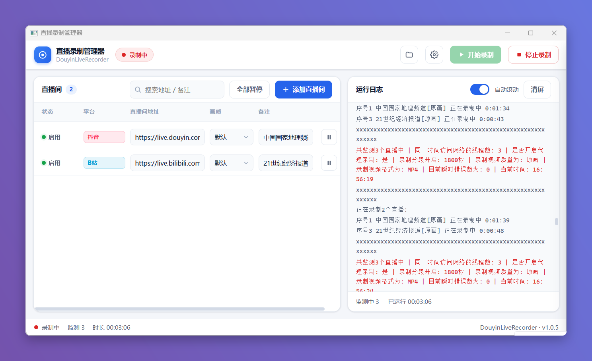

# 直播录制管理器

> 本脚本是开源项目 DouyinLiveRecorder（作者 **Hmily**）的「不忙脚本盒子」封装版。**上游项目代码原封不动引用**，我们只在外层增加了**图形化管理界面**与**盒子适配**（读取参数 JSON、写入配置、进程启停与日志管理）。感谢原作者与所有贡献者。

---

## 核心特性

- **40+ 平台**：抖音、TikTok、快手、虎牙、斗鱼、YY、B站、小红书、bigo、blued、SOOP、网易CC、猫耳FM、Twitch、Youtube、淘宝、京东、咪咕、Acfun、知乎等。
- **可视化管理**：图形面板里增删直播间，逐个设置画质、备注，并支持**单独暂停/恢复某个直播间**（即时生效），无需手改配置文件。
- **灵活录制**：可设保存路径、保存格式（ts/mkv/flv/mp4/mp3/m4a）、默认画质、分段录制、完成后自动转 mp4。
- **循环值守**：按设定间隔循环监测，主播开播自动录制，结束自动保存。
- **实时日志**：面板内实时查看录制日志与监测数量，随时开始 / 停止。
- **环境免装**：FFmpeg、Node.js 由盒子自动准备，普通用户无需手动安装。

---

## 脚本演示

---

## 安装方法

本脚本的运行环境、依赖组件及图形化窗口均依赖「不忙脚本盒子」，建议仅通过盒子安装和使用本脚本。

> 前置条件：安装好 [不忙脚本盒子](https://www.bm-box.cn)

* 打开盒子 → **脚本市场** → 搜索 **「直播录制管理器」**
* 点击「安装」（等待安装完成）

---

## 使用方式

* 直接启动
  * 在盒子里点击脚本卡片运行
  * 在弹出的管理面板中点击「+ 添加直播间」，在弹窗中填写直播间地址、**选择保存目录**（必填，全局生效）、可选画质与备注
  * 可选择每个直播间的画质、填写备注；需要停止某个直播间时点该行的「暂停」
  * 在下方「全局设置」里配置保存格式、分段等，点「保存设置」
  * 点击「开始录制」，面板右侧实时显示运行日志与监测数量
  * 录制期间可单独暂停/恢复某个直播间，或点「停止录制」；关闭面板窗口即停止录制

---

## 💡 使用提示

- **保存格式**：强烈建议使用默认的 `ts`。异常中断时 ts 不易损坏，录制完成后工具会自动按需转成 mp4。
- **画质**：默认 `原画`；单个直播间可在其画质下拉里单独指定。
- **暂停 / 恢复某个直播间**：点该行「暂停」，约几秒内停止该直播间的监测与录制（已录部分会正常保存）；点「恢复」重新加入监测。
- **单独设置范围**：受上游命令行能力限制，**仅「画质」和「备注」可按单个直播间设置**，保存格式、分段、保存路径、Cookie 等均为全局设置。
- **循环间隔**：长时间值守建议把「循环间隔」设大一些（如 300 秒），避免请求过频被平台风控。
- **海外平台**（TikTok、SOOP、Twitch 等）：需开启「使用代理」并填写代理地址，如 `127.0.0.1:7890`。
- **Cookie**：抖音等平台可能需要 Cookie，可在「Cookie（高级）」中填写。
- 录制的视频默认保存在安装目录的 `downloads` 文件夹内，可在「保存路径」中自定义。

---

## 🖥️ 环境要求

| 项目 | 要求 |
| --- | --- |
| **操作系统** | Windows 10+（64 位） |
| **运行环境** | Python 3.10+（盒子自动准备） |
| **外部工具** | FFmpeg、Node.js、webview-cli（盒子自动下载） |
| **网络** | 首次安装需联网；录制海外平台需代理 |

---

## 🙏 鸣谢

本脚本的核心录制能力完全来自开源项目 **DouyinLiveRecorder**，在此向原作者与所有贡献者致以诚挚感谢：

- 项目地址：https://github.com/ihmily/DouyinLiveRecorder
- 作者：**Hmily** 及各位贡献者
- 开源许可：MIT

本仓库仅在其**外层**做「不忙脚本盒子」适配与图形化封装；`app/` 目录为上游代码**原封不动**引用，**未修改其核心录制逻辑**。完整原始说明见 `app/README_upstream.md`。

